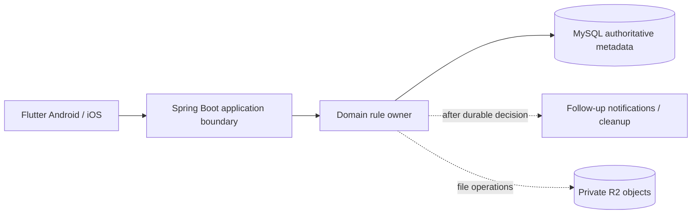

# UniSpace Backend — B0-02 Module Ownership & Dependencies

> **Document ID:** B0-02  
> **Version:** v0.1.1 — v1.1 flow-addendum reconciliation  
> **Prepared:** 22 November 2026  
> **Status:** **B0.2/B0.3 principles and User Flows Addendum v1.1 traceability are approved; final consolidated Backend B0 sign-off is pending.**  
> **Companion:** [`B0-01 Requirements Traceability Matrix`](./UniSpace_B0-01_Requirements_Traceability_Matrix_v0.2.1_Aligned.xlsx)

## 1. Scope, authority and important distinctions

This document records **logical ownership and dependency rules**, **not** Java package boundaries, deployed services, database tables, endpoint paths or completed implementation. The user approved B0.2 module boundaries and B0.3 dependency principles on 19 November 2026. Where this document proposes a particular interaction, it is explicitly labelled **B1 candidate**.

**Source precedence:** (1) approved Functional Requirements v1.5 (FR-001–137) and approved Addendum v1.0 (FR-138–167); (2) approved IA plus addendum; (3) approved 67 User Flows and later approved Stage 3.5 decisions; (4) approved 42 NFRs. The *Backend Engineering Starter Pack v0.1* is a **technical draft**, not an approved API, ERD or implementation contract. The approved User Flows & User Journeys Addendum v1.1 (22 November 2026) resolves the documented MVP flow gaps and earlier “unresolved” statements in the original v1.0 flow document.

**Release inventory:** 167 FRs total = **150 MVP** + **17 post-MVP**. Every MVP FR has **one primary logical owner** in B0-01. Multiple collaborating modules are permitted; a cross-reference is not double counting.

## 2. Approved logical ownership — MVP

| Primary responsibility group | MVP FR count | Primary FRs (each occurs once in this table) | Boundary / responsibility |
|---|---:|---|---|
| Application & API Integration | 1 | FR-001 | Shared Flutter↔Spring Boot integration contract; transport-level orchestration and consistent API-facing behavior. Does not own other modules’ authorization decisions. |
| Identity, Authentication & Sessions | 35 | FR-002–004, FR-006–009, FR-113–137, FR-156, FR-158, FR-167 | Google/Apple provider proof and secure linking; provisional registration; verified university email OTP; Student ID identity uniqueness; sessions, device trust and resource authorization primitives. |
| Administration & Policy | 13 | FR-005, FR-010–013, FR-101–104, FR-109, FR-112, FR-144, FR-157 | Staff role requests and decisions; system role transitions and last-Admin rule; Admin-only user directory; institutional ID/domain policy configuration; authority to initiate exceptional Admin actions. |
| Channels & Membership | 30 | FR-014–035, FR-110–111, FR-138–142, FR-166 | Channel lifecycle and 0–6 membership; one active student membership; owner relationship and transfer; join/switch/leave; owner/Admin approvals; eligible channel deletion; force owner removal policy. |
| Uploads & Storage | 25 | FR-036–055, FR-145–149 | Authorize upload intent; enforce type and size limits; lifecycle and transfer metadata; interrupted sessions; publish only verified safe content; prevent filename overwrites; isolate remote-object concerns. |
| Library & Media Access | 17 | FR-056–066, FR-159–162, FR-164–165 | Authorized file discovery/search/metadata and viewer access; per-user video progress; bounded media URL issuance; PPT/PDF preview guidance; authorized offline export. |
| File Management & Trash | 14 | FR-067–079, FR-143 | File rename, move, Trash, restore, permanent deletion; state/permission checks; last-channel restore; retention and cleanup coordination without deleting channels. |
| Notifications | 13 | FR-080–089, FR-152–154 | Durable user inbox; read/unread and user preferences; membership, role, upload and Admin alerts; best-effort push; 90-day retention. |
| Audit | 2 | FR-108, FR-155 | Required audit-event capture for protected mutations; confidentiality and 365-day retention. In-app audit browsing is deferred. |
| **Total** | **150** | **FR-001–167, excluding 17 post-MVP FRs** | **Nine MVP ownership groups; no requirement is assigned twice as primary.** |

### Post-MVP primary ownership (17 FRs)

| Owner | Deferred FRs | Count | Boundary |
|---|---|---:|---|
| Google Drive Resources (Post-MVP) | FR-090–100, FR-150–151 | 13 | External, permission-controlled Google Drive resources; no copying into UniSpace central R2 by default. |
| Administration & Policy | FR-105–107 | 3 | In-app operational status/statistics and Admin audit browsing/search; MVP still needs underlying service observability and core audit capture. |
| Library & Media Access | FR-163 | 1 | Enhanced PDF reading; MVP still includes basic PDF preview. |
| **Total** | | **17** | |

**Cross-owner requirements that must not be misclassified:** FR-144 is primary Administration, with Channels enforcing membership/ownership prerequisites; FR-142 is primary Channels with effects on File Management and Media authorization; FR-147 is primary Uploads, with uniqueness enforcement reused by rename/move operations; FR-154 is primary Notifications while the Channels module owns the approval decision; FR-166 is primary Channels with an Admin-only initiating permission. See B0-01 for exact rows.

## 3. B0.3 — approved dependency principles

1. **Single rule owner:** Each business invariant has one authoritative home even when other modules initiate the use case.
2. **Explicit collaborations:** Cross-module business calls use defined application interfaces; dependent follow-up work may use events. No arbitrary cross-module repository/database-table access.
3. **Synchronous for immediate decisions:** Authorization, membership capacity, owner succession, Admin eligibility and other immediate user-visible decisions must be resolved before reporting success.
4. **Asynchronous for follow-up work:** Push delivery, email, object cleanup and recoverable external operations may proceed asynchronously without corrupting the committed business outcome.
5. **Avoid circular dependencies:** Module contracts must be reviewed so responsibilities do not create cycles. A common interface is not permission to bypass the rule owner.
6. **Critical data consistency:** The owner coordinating a use case is responsible for requesting coherent changes, but final transaction and interface placement remains a B1/B2 design choice.

## 4. Collaboration candidates for B1 design (not yet approved contracts)

| Initiating context | Rule owner / collaborator | Why an immediate decision is needed | Follow-up/event candidate | Status |
|---|---|---|---|---|
| Authentication / onboarding | Identity + Administration policy | Institutional ID format/email-domain validation | Verification email dispatch | B1 candidate |
| Channel membership request | Channels & Membership | Eligible request; one membership; 6-seat cap; correct approver | Notification to owner or all active Admins | B1 candidate |
| Empty-channel approval | Channels & Membership | Single decision, first-member owner, at most 6 | Notify applicant; audit decision | B1 candidate |
| Voluntary leave/switch | Channels & Membership | Atomic successor assignment and membership change | Notify parties; audit | B1 candidate |
| Exceptional Admin owner removal | Administration authorization → Channels invariant owner | Admin-only exception; atomic successor/removal | Notify affected user; audit | B1 candidate |
| Student → staff promotion | Administration & Policy ↔ Channels | Membership resolved before role change; preserve last Admin | Role-change notification and audit | B1 candidate |
| Channel deletion | Channels & Membership ↔ file state provider | No members, no active files, no Trash files; cancel requests | Notify cancelled requesters; audit | B1 candidate |
| Upload initiation/finalization | Identity permissions + Channels + Uploads & Storage | Permitted actor/destination; size/type/safety; READY gating | Completion/failure notification, remote cleanup | B1 candidate |
| File rename/move/restore/delete | File Management & Trash ↔ Channels, Media metadata | Current permissions, destination, unique name, state | Audit and remote-object cleanup | B1 candidate |
| Playback / offline export | Library & Media Access ↔ Identity/Channels | Fresh current authorization; valid file state | Persist per-user playback progress | B1 candidate |
| Any important mutation | Audit | Record required event with safe metadata | Optional operations pipeline | B1 candidate |

*Direction in this table describes responsibility, not concrete Java dependencies. B1 must select acyclic ports/interfaces or orchestration where the same two groups must collaborate in both directions.*

### Approved priority of effects

This is a **conceptual illustration**. MySQL and R2 cannot participate in a single ordinary DB transaction; the mechanism for durable dispatch/reconciliation is **not yet approved**.

## 5. Ownership guardrails from approved product behavior

- **System roles:** STUDENT, SUB_MANAGEMENT, MANAGEMENT, ADMIN only; channel Owner is a **relationship**, not a fifth role. Initial Admin provisioned out of ordinary registration; last active Admin protected (FR-005, FR-012, FR-112).
- **Channel admission:** maximum 6 active student members; maximum one active channel/student; Admin handles 0/6 requests; first admitted student becomes owner; owner handles joins once occupied (FR-014–035, FR-110–111, FR-139).
- **Owner transition:** owner cannot leave/switch with remaining members without selecting an active successor; force owner removal is an Admin-specific exception, not unrestricted Admin removal of ordinary members (FR-138, FR-166).
- **Deletion:** Admin-only; zero members, zero active media, zero Trash; pending join/switch requests cancelled and affected users notified, decision audited (FR-140–141).
- **Central files:** original uploader remains attributable; upload safe before publication; no user-created nested channel folders; numbered name collision resolution; Trash 30 days, restore to the last channel before Trash (FR-036–079, FR-143, FR-145–149).
- **Identity:** Google/Apple linking requires verified provider ownership, not email-only identity merges; OTP 10 minutes, resend 60 seconds, five incorrect attempts; trusted-device status and session-token expiry are separate (FR-156, FR-158, FR-167).
- **Data retention:** notification inbox 90 days, audit 365 days unless applicable institutional/legal obligations supersede; no credentials/secrets in audit records (FR-152, FR-155).
- **Native exports:** authorized offline files copied to Android Downloads/iOS Files become user-controlled; cannot reliably revoke copies after export (FR-164–165).

## 6. Non-goals and unresolved B1/B2/B3 choices

**Not defined/approved by B0:** exact feature package names; Spring Modulith or custom interface approach; transaction isolation/locking mode; DB indexes and unique constraints; event payloads/queues/outbox schema; API endpoint naming; token/session representation; R2 presigned or proxy upload details; scanner engine; retry/backoff policy; database migrations. These need design review and tests, not guesses embedded as product policy.

## 7. B0 review checklist

- [x] Every one of 150 MVP FRs assigned exactly one primary owner in B0-01.
- [x] Deferred 17 FRs separated from the MVP.
- [x] B0.3 synchronous vs. asynchronous principle recorded.
- [x] Review all **21 supplemental** requirement→flow mappings: approved User Flows Addendum v1.1; recorded in B0-01 v0.2.1.
- [x] Document four additional MVP journeys covering five FRs; defer three post-MVP journey gaps; record system-level acceptance criteria for FR-079 and FR-155. Implementation/test evidence remains future work.
- [ ] Final user approval for this consolidated B0 document set.

## 8. References

1. `UniSpace_Functional_Requirements_v1_5(2).pdf` — original FR-001–137, including role rules and file permissions.
2. `UniSpace_Functional_Requirements_Addendum_v1_0(1).pdf` — approved FR-138–167, pp. 1–6.
3. `UniSpace_User_Flows_and_User_Journeys_v1_0(1).pdf` — 67 approved flows, original baseline; older unresolved notes superseded by later approved addendum.
4. `UniSpace_Product_Decisions_and_MVP_Scope_v1_0_REVIEW(2).pdf` — Stage 3.5 approved individual decisions assembled in a *review-draft* document.
5. `UniSpace_Non_Functional_Requirements_v1_0(1).pdf` — 42 approved NFRs.
6. `UniSpace_Backend_Engineering_Starter_Pack_v0_1(1).pdf` — **technical draft only**, not an approved implementation contract.
7. `UniSpace_User_Flows_and_User_Journeys_Addendum_v1_1_FINAL(1).md/.pdf` — approved 22 November 2026, four new journeys, 21 amendments, two system checks and three deferred flow gaps.
8. Approved B0.2/B0.3 conversations, 19 November 2026; B0-01 v0.2.1 workbook reconciles the approved traceability.
