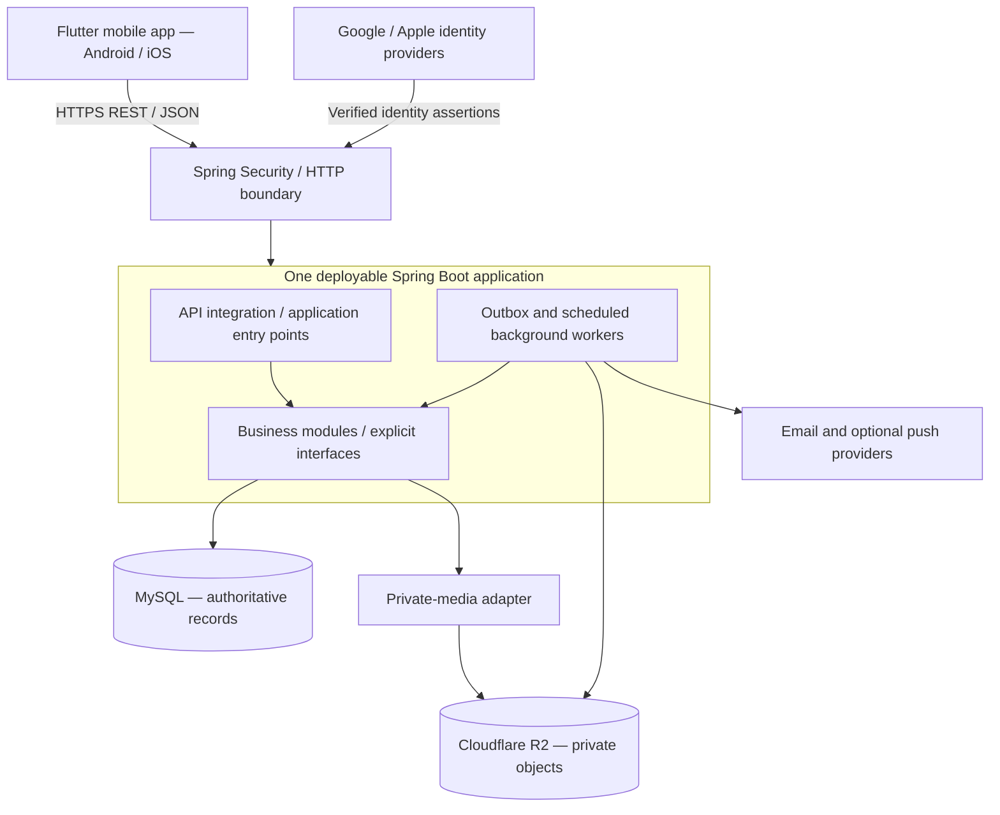
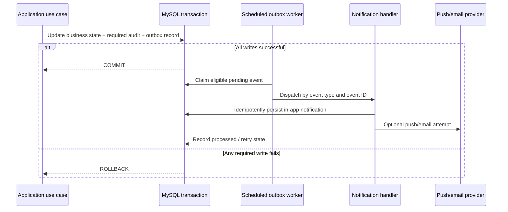

# UniSpace — B1 Backend Architecture Specification

**Document ID:** B1  
**Version:** v1.0 — consolidated review candidate  
**Prepared:** 22 November 2026  
**Decision status:** **B1.1–B1.5 APPROVED; B1.6 consolidated review and final sign-off PENDING.**  
**Implementation status:** Architectural planning only; this document does not establish that application code, database schema, endpoints, or tests exist.

> **Change-control rule:** Do not treat an architectural recommendation, package sketch, future-stage decision, or historical draft as a new approved product requirement. Where a historical baseline says “unresolved,” apply the later approved functional and user-flow addenda. B0's final consolidated sign-off remains separately recorded as pending in its handoff README; approval of individual B1 principles does not silently change that record.

---

## 1. Purpose and source-of-truth order

Define the initial backend architecture for the UniSpace Flutter application, including deployable boundaries, logical modules, collaboration rules, transaction semantics, reliable follow-ups, security ownership, and deployment environments. This document deliberately **does not** finalize MySQL DDL, API endpoints, session-token representation, Spring implementation classes, or cloud provisioning.

Use the following precedence when implementing or reviewing:

1. Approved Functional Requirements v1.5 **FR-001–137** and approved FR Addendum v1.0 **FR-138–167**.
2. Approved Information Architecture v1.0 **together with** approved IA Addendum v1.0.
3. Approved original User Flows & Journeys v1.0 (**67 stable flows**) **together with** approved User Flows Addendum v1.1 (**four addendum journeys, 21 controlled amendments and two system-level acceptance items**).
4. Approved 42 Non-Functional Requirements v1.0.
5. B0-01 requirements traceability v0.2.1, B0-02 module ownership v0.1.1, B0-03 transaction/concurrency principles, and B0-04 risk register.
6. This B1 architecture for **technical structure only**; the earlier Backend Engineering Starter Pack is an **unapproved historical draft**.

**Inventory:** 167 approved FRs = **150 MVP + 17 post-MVP**. The B0-01 workbook assigns exactly one primary ownership group to each MVP requirement. Do not infer that all approved FRs have been implemented.

## 2. Decision register and scope

| Decision | Approved architecture | Approval |
|---|---|---|
| **B1.1 Overall architecture** | Java 21 LTS, Spring Boot, feature-based modular monolith, **one deployable backend application** initially; MySQL authoritative data; private Cloudflare R2 media; Flutter Android/iOS client over HTTPS REST/JSON. | Approved |
| **B1.2 Code organization** | One Maven project with domain/feature-oriented Java packages. Each feature can organize API, application, domain and persistence internally; infrastructure adapters separated. | Approved |
| **B1.3 Collaboration** | Explicit application interfaces; synchronous calls for decisions needed before success; asynchronous events for follow-up; no direct cross-module repository access or circular feature dependencies; a workflow coordinator for multi-owner use cases. | Approved |
| **B1.4 Consistency** | Spring-managed MySQL transactions for atomic business decisions; a MySQL transactional outbox and internal worker for durable asynchronous follow-up; idempotent retries and event handlers; safe MySQL–R2 reconciliation; required audit events persisted atomically where applicable. | Approved |
| **B1.5 Security and infrastructure** | Spring Security, backend validation of Google/Apple proof, separate session expiry and device trust, resource-level authorization, HTTPS, private database and R2, short-lived authorized media delivery, secrets outside source control, local/test/pilot/prod environment separation. API and workers can share one process initially. | Approved |
| **B1.6 Consolidated review** | Validate this specification and record explicit final B1 sign-off before using it as a locked architecture baseline. | **Pending** |

### MVP scope protection

- **MVP:** 150 FRs, including required audit **capture** (FR-108/155), core PDF/PPT preview, channel/media management, in-app notifications, authorized native file export (FR-164–165), and Google/Apple sign-in linking (FR-167).
- **Post-MVP:** Google Drive Resources **FR-090–100, FR-150–151** (13); in-app Admin monitoring/audit browsing **FR-105–107** (3); enhanced PDF controls **FR-163** (1).
- The **Resources tab** remains part of approved navigation. Its precise MVP unavailable/placeholder presentation is a Stage 4 UI decision; this does not authorize implementing deferred Drive integration.
- Cross-cutting protections, basic operational observability and audit *recording* are still required where applicable; postponing an Admin UI does not postpone security and audit foundations.

## 3. Logical system architecture



**Diagram interpretation:** Logical paths only. It does not authorize direct controller-to-database bypasses, public R2 buckets, or arbitrary feature-to-feature dependencies. Google/Apple provider sign-in is distinct from the deferred Google Drive authorization feature.

### Runtime and deployment boundary

- Initially one Maven-built Spring Boot application, one Java runtime/process for REST endpoints plus internal background workers, and one MySQL-backed persistence system.
- Cloudflare R2 is **external private object storage**, not the authoritative source of role, membership or file access rights.
- Initially **no mandatory** Kubernetes, microservices, Redis, Kafka, RabbitMQ or standalone worker server. A future change would require an architectural decision.
- Pilot deployment can move beyond a laptop, but production environment sizing, availability, backup recovery targets and infrastructure provisioning are not finalized by B1.

## 4. Nine B0 responsibility groups mapped to Java feature packages

> B0's nine groups are **primary FR ownership classifications**, not a requirement to deploy nine services. There are eight business-feature packages plus a cross-cutting API/integration boundary.

| B0 primary logical owner | MVP FRs | Proposed B1 Java location | Responsibility / restriction |
|---|---:|---|---|
| Application & API Integration | 1 | `com.unispace` application entry / shared HTTP integration | Shared Flutter↔backend HTTP contract; never decides another domain's permissions. |
| Identity, Authentication & Sessions | 35 | `identity` | Provider identity, onboarding, OTP, session/device trust, identity uniqueness and authentication primitives. |
| Administration & Policy | 13 | `administration` | Role requests/changes, last-Admin rule, policy configuration and authorization to initiate exceptional Admin actions. |
| Channels & Membership | 30 | `channel` | Membership counts/capacity, channel owner, approvals, leave/switch, channel lifecycle and exceptional owner removal invariants. |
| Uploads & Storage | 25 | `upload` | Upload sessions, validation, resumability and publishing gate; remote object operations via adapter. |
| Library & Media Access | 17 | `media` | Authorized listing/viewing/search, video progress, document preview and offline delivery authorization. |
| File Management & Trash | 14 | `filemanagement` | Rename, move, Trash, restore, permanent-delete state and destination decisions. |
| Notifications | 13 | `notification` | Durable inbox, preferences, notification read state and optional push follow-up. |
| Audit | 2 | `audit` | Required durable event records, safe metadata and retention. |
| **Total** | **150** | | |

**Cross-owner details:** FR-144 primary owner = Administration, with Channel membership prerequisites; FR-142 primary owner = Channels, with consequences for file/media access; FR-147 primary owner = Uploads, reused collision behavior during file operations; FR-154 primary owner = Notifications, not the join decision; FR-166 primary owner = Channels, with Admin initiation/authorization.

The post-MVP Google Drive Resources module is **not an MVP implementation package requirement**. It can be introduced later under an explicit feature boundary.

## 5. Java code-organization proposal adopted in B1.2

```text
src/main/java/com/unispace/
├── UniSpaceApplication.java
├── identity/
│   ├── api/                 # feature HTTP handlers and DTOs
│   ├── application/         # use cases, exported application interfaces
│   ├── domain/              # business rules / domain model
│   └── persistence/         # feature-owned entities and repositories
├── channel/                 # same optional four internal areas
├── administration/
├── upload/
├── media/
├── filemanagement/
├── notification/
├── audit/
└── infrastructure/
    ├── security/
    ├── storage/
    ├── messaging/
    ├── outbox/
    └── config/
```

This is a **package ownership blueprint**, not a commitment to create every empty folder or a final list of Java types. `infrastructure` holds technology adapters and reusable plumbing; it must not become a second home for channel, identity, media or role business rules. An API/integration concern can exist at the application root or as a narrowly scoped shared package, but should not turn into a repository-calling “god service.”

### Internal layer meaning

- **`api`** — HTTP boundaries, DTO validation/serialization and presentation of results/errors. Never equate a displayed action with granted permission.
- **`application`** — business use-case entry points, workflow coordination, transaction boundaries, exported interfaces, idempotent orchestration.
- **`domain`** — feature-owned invariants, rules and domain objects; no infrastructure credentials.
- **`persistence`** — feature-owned MySQL persistence. Repositories are not called from other feature packages.
- **`infrastructure`** — Spring Security integration, private R2 adapter, outbox worker mechanism, configuration, provider gateways.

Avoid a global `repository/`, global `service/` or shared `entity/` package spanning all features. API DTOs and persistence entities have distinct responsibilities.

## 6. B1.3 cross-module communication contract

### Binding principles

1. **One invariant owner.** Every business rule has one module accountable for enforcing it.
2. **Synchronous for decisions:** identity, policy, access, channel seat/ownership, active file state, role transition and approval validity are checked before claiming success.
3. **Asynchronous for follow-up:** push, email dispatch, external object cleanup and recoverable notification workflows are not required to finish before the primary business commit.
4. **Explicit exported application interfaces / ports.** Do not import another module's persistence entities or repositories. A direct call must follow an approved dependency direction.
5. **No cyclic feature dependencies.** Multi-owner interactions use narrowly scoped interfaces and/or an application workflow coordinator rather than mutually injecting full feature services.
6. **Backend authority.** Client-side validation accelerates UX but is never the security or data-integrity authority.

### Critical collaboration scenarios

| Use case | Immediate owner / collaborator decision | Durable follow-up |
|---|---|---|
| Register user | Identity verifies provider/OTP; Administration owns institutional policy | Email dispatch / audit as required |
| Join occupied/empty channel | Channels validates role/current membership/capacity, correct approver, first owner | In-app notification and optional push; audit |
| Owner leaves/switches | Channels validates successor, member state and destination | Notify; audit |
| Exceptional Admin owner removal | Admin validates initiating authority; Channels applies narrow owner-removal invariants | Notify affected user; audit |
| Student-to-staff promotion | Coordinator consults Administration and Channels; membership resolved before role changes | Role notification; audit |
| Delete channel | Channels confirms zero members; file-state owner confirms zero active **and** Trash files; cancel pending requests | Notify cancelled applicants; audit |
| Upload / finalize | Uploads validates current authorization, size/type, complete verification and safety before READY | Storage reconciliation; notification/audit |
| Rename / move / Trash / restore | File Management enforces authorized state/destination; Channels checks current rights; reuse safe unique naming | Audit, deferred cleanup if needed |
| View / export | Media revalidates current user/file/channel permissions; private delivery adapter | Optional playback progress persistence |

**Cycle-resolution rule:** Table cells describe conceptual collaborators, **not** permission to create reciprocal package imports. B1.3 approved workflow coordination as a pattern; exact port names, placements and dependency graph require verification when packages are implemented.

## 7. B1.4 transactional consistency

### Invariants inherited from B0-03

The backend must preserve the 14 B0 invariants (INV-01–INV-14), including:

- At most one active student channel membership; **0–6** members/channel; exactly one eligible owner for occupied channels.
- First admitted member of a 0/6 channel becomes owner; owner succession/departure is atomic; Admin owner-removal is a narrow exception.
- Delete a channel only with **0 members, 0 active files and 0 Trash files**, cancelling pending requests consistently.
- Preserve at least **one active ADMIN**; resolve student membership before staff promotion.
- Enforce live authorization, original uploader identity, safe upload-publication gating and numbered filename conflict resolution.
- Restore only to pre-Trash last channel with current authorization; maintain required inbox/audit durability, resumable upload state and MySQL–R2 recovery.

### Approved transaction model

- Use **Spring-managed MySQL transactions** for one logically atomic business mutation. Transaction boundaries belong to **application use-case entries/coordinators**, not uncontrolled controller chains.
- A workflow that spans logical modules must still coordinate one coherent MySQL change, using explicit module interfaces. Whether all changes participate in the same transaction is reviewed per use case; no module may mutate another's tables as a shortcut.
- Persist **required audit records in the same MySQL transaction** as their associated protected mutation, when an audit record is a required success condition.
- Persist the corresponding **outbox event in that same transaction** when reliable asynchronous follow-up is required. Failure to persist a required audit/outbox record causes the domain transaction to fail rather than report a durable success without evidence.
- Do not hold long-running MySQL transactions open over R2 transfer, remote OAuth exchange, email send or push delivery.
- Use idempotent mutation processing and database constraints to prevent duplicates, plus concurrency tests for races such as seat #6, first owner, last Admin and restore vs. deletion.

**Deferred detail:** concrete isolation levels, row locking, optimistic versioning, uniqueness indexes, transaction propagation and exact workflow signatures are designed and tested in B2/B3; this document does not assume they are finished.

## 8. Transactional outbox — approved pattern

### Why it exists

Sending a push/email directly inside a database transaction creates a dual-write problem: a database commit may succeed while delivery fails, or an external side effect may happen before a database rollback. MySQL cannot roll back an already sent notification.

### Agreed approach



1. A domain operation commits its business state, required audit evidence and event record **atomically in MySQL**.
2. A worker **inside the same Spring Boot process** initially polls/claims committed events. Spring scheduling is sufficient for an initial implementation; polling interval is not chosen.
3. The appropriate feature handler creates durable inbox state or starts the external task. Optional push failures must not reverse committed membership/role/file decisions.
4. Failures are retried safely, with delayed reprocessing and visibility into persistent failures.
5. Delivery is **at least once**: a crash after delivery but before acknowledging may reprocess an event. Persist a stable event ID and design consumers to be **idempotent**. External push duplicates remain possible; do not promise globally exactly-once delivery.

**Implementation controls to specify later:** outbox schema, payload versioning, claiming and lease expiration, retry/backoff, permanent-failure handling, idempotency constraints, event retention and operations alerting. Do not make the worker depend on an in-memory event list or on successful external delivery to finalize a business transaction. Events must avoid OTPs, tokens and personal secrets.

**Audit distinction:** The required audit record is a **synchronous durable database write**. Merely queuing an audit intent for later delivery does not satisfy the approved audit-persistence guarantee.

## 9. MySQL and private R2 — consistency and media delivery

MySQL and R2 cannot join the same ordinary database transaction. For upload, finalize, Trash and physical deletion flows:

- MySQL stores authoritative user, membership, metadata, upload state and file access decisions.
- The upload/file lifecycle must never publish incomplete, oversized, invalid or unverified media. Media can become available only after integrity/safety checks succeed.
- Remote-object operations use **state tracking, retries and reconciliation**. Inconsistencies such as orphan objects, incomplete multipart parts or missing stored objects must be detectable and recoverable.
- Authorized media delivery uses **short-lived methods** (for example time-limited URLs or an authenticated proxy, choice deferred). No public R2 objects, persistent unauthenticated links or R2 master credentials in Flutter.
- Check current authorization before issuing new playback/download access. A previously issued signed URL may remain usable until expiry; later stages must assess the practical revocation window.
- Authenticated exports to **Android Downloads / iOS Files** create **user-controlled offline copies** that UniSpace cannot later guarantee to revoke. Google Drive external resources are out of scope for the MVP central-media export.

**Deferred:** multipart protocol details, object-key naming, scanner engine, exact file-state enum, signed URL time-to-live and cleanup/reconciliation schedule belong to B2/B3/B7/B8 design.

## 10. B1.5 security and trust boundaries

| Boundary | Architecture requirement |
|---|---|
| Flutter → API | HTTPS; Spring Security protects each endpoint; invalid/expired sessions are rejected. NFR-SEC-001 requires TLS 1.2+ (prefer 1.3 where supported). |
| Identity provider → UniSpace | Backend validates Google/Apple proof and provider subject (FR-167); **do not link accounts by email match alone**. Enforce uniqueness and atomic linking. |
| Registration → ACTIVE | Provisional users cannot bypass required profile/Student ID/university-email verification. Admin-configurable institutional rules apply prospectively and do not retroactively invalidate ACTIVE accounts. |
| OTP → account/device | OTP: **10-minute expiry**, **60-second resend cooldown**, **5 failed attempts**, single use/replacement invalidation. Server is authoritative. |
| Session vs. trusted device | Expiring/revocable authentication credentials and independent device trust; no fixed device-trust expiry, but sign-out/revocation/security events end trust per approved policy. |
| Role/channel/file rights | Backend verifies current role, membership, owner relationship, original uploader/file permission and file state for each protected operation; access is not conferred by a cached screen, saved link or old membership. |
| MySQL | Private access, least-privilege database credentials, migrations and backup/recovery planning; never embed credentials in Git. |
| R2 | Private bucket/object store; backend-owned credentials and bounded authorized access. |
| Logs/audit/events | Redact secrets, access tokens, OTPs, credentials and sensitive request material. Audit retention **365 days**, subject to overriding institutional/legal obligations. |
| Notifications | Durable in-app notification history **90 days**; push preference categories influence optional push, not required inbox events. |
| Trash | Up to **30-day** recovery retention; no automatic deletion of empty channels. |

### Deployment environment separation

| Environment | Intended use | Distinguishing consideration |
|---|---|---|
| `local` | IntelliJ/Windows developer machine | Isolated developer configuration and credentials; no production secrets or public MySQL exposure. |
| `test` | Automated unit/integration/security and concurrency tests | Isolated data/storage substitutes and repeatable failure-injection tests. |
| `pilot` | Small controlled real-user validation | HTTPS, access restrictions, metrics, backup and recovery drills before real data exposure. |
| `prod` | Later university-scale deployment | Explicit sizing, protection, observability and recovery criteria; not assumed ready. |

The initial API and workers share one process. Network segmentation, hosting service, secret manager, device support matrix, MySQL connectivity, production recovery targets and rotation procedures remain later infrastructure decisions.

## 11. Quality and B0 technical-risk alignment

| B0 risk | Design response | Evidence required later |
|---|---|---|
| R01 Unauthorized access (Critical) | Backend resource authorization, private R2 and short-lived delivery. | Cross-role/file/expired-permission tests. |
| R02 Concurrent membership conflicts (Critical) | Transactional ownership/capacity rules, DB constraints and serialized decisions. | Parallel join/owner/last-seat tests. |
| R03 Unsafe/incomplete uploads (Critical) | READY gating after complete verification/safety checks. | Failure-injection and adversarial upload tests. |
| R04 MySQL–R2 inconsistency (High) | Reconciliation state and retryable cleanup. | Crash/outage recovery tests. |
| R05 Interrupted uploads (High) | Persisted resumable transfer state and max three concurrent device uploads. | Kill/restart/reconnect tests. |
| R06 Auth/session vulnerabilities (Critical) | Verified identities, OTP safeguards, separate device trust and token expiry. | Revocation, replay, account-link tests. |
| R07 Duplicate retries (High) | Idempotent workflows and event consumers; uniqueness constraints. | Replayed HTTP and outbox processing tests. |
| R08 Notification failures (Medium) | Durable outbox/inbox and optional push retry. | Push outage while approval remains committed. |
| R09 Laptop limitations (Medium) | Small controlled pilot, metrics and phased capacity validation. | CPU/RAM/latency monitoring under representative load. |
| R10 Accidental data loss (High) | Transactions, retention discipline, DB backup and restore planning. | Backup/restore and expiry tests. |

Refer to B0-03's **INV-01–INV-14** and **CT-01–CT-12** for acceptance-oriented concurrency and recovery cases. NFR objectives are approved requirements, **not measured achievements**.

## 12. Explicitly deferred engineering decisions

| Stage / workstream | Must be designed without altering approved product behavior |
|---|---|
| **B2 Database architecture** | Tables/DDL, entity relations, Flyway migrations, keys/indexes, optimistic/pessimistic locking, isolation, invariant enforcement, outbox/audit schema and R2 metadata links. |
| **B3 Security/API contracts** | Endpoint names and DTOs, stable error model, idempotency-key behavior, session/refresh-token form and lifetimes, Google/Apple proof integration, exact auth flows and role/resource test matrix. |
| **Upload/media implementation** | Multipart orchestration, object naming, safety scan integration, file-state machine, signed-media delivery/renewal, R2 compensation/reconciliation. |
| **Worker & notifications implementation** | Poll timing, event schema, processing leases, retry/backoff, poison-event operations, push gateway and inbox deduplication. |
| **Testing/operations** | Test evidence, backup RPO/RTO, production deployment network, observability/alerting, reference device and performance workload definitions. |
| **Stage 4 mobile UX** | Specific screens/components for provider linking, institutional settings, Admin owner-removal confirmation, native export UX, and MVP Resources-tab state. |

No architecture passage here authorizes implementing post-MVP features or inferring unapproved UI permissions.

## 13. B1.6 review checklist — **not yet signed off**

- [x] Approved B1.1–B1.5 decisions documented in one place.
- [x] B0-01 release totals and nine MVP ownership groups reflected (150 MVP, 17 post-MVP).
- [x] Original 67 user flows plus approved four-journey v1.1 addendum recognized.
- [x] Explicit module collaboration and no cross-module repositories/circular feature dependencies.
- [x] Spring/MySQL transactions, atomic required audit, durable outbox, idempotency and R2 reconciliation covered.
- [x] Server-side authentication, authorization, private storage, secrets and environment trust boundaries covered.
- [x] Deferred API, schema, token, locking and mobile UX choices explicitly identified.
- [ ] **Reviewer confirms the consolidated wording is accurate and approves B1.6 final sign-off.**
- [ ] Reconcile B0 consolidated sign-off record if/when separately approved; do not backdate or infer approval.

### Proposed B1 completion record (to fill only after explicit approval)

- **Final approval date:** Pending
- **Approved specification/version:** Pending
- **Reviewer decision:** Pending
- **Authorized next phase:** **B2 — Database Architecture & Schema Design**, after B1.6 final sign-off and B0 status reconciliation.

## 14. Source documents and intended repository placement

**Save this file as:** `docs/architecture/B1/B1_Backend_Architecture_v1.0.md`.

| Document | Purpose |
|---|---|
| `docs/architecture/B0/UniSpace_B0-01_Requirements_Traceability_Matrix_v0.2.1_Aligned.xlsx` | Authoritative per-FR release, ownership and flow traceability. |
| `docs/architecture/B0/B0-02_Module_Ownership_and_Dependencies_v0.1.1.md` | Nine B0 groups and module collaboration principles. |
| `docs/architecture/B0/B0-03_Transactions_and_Concurrency.md` | 14 invariants, critical transaction operations and proposed later concurrency tests. |
| `docs/architecture/B0/B0-04_Technical_Risk_Register.md` | R01–R10 approved risk categories/mitigation directions. |
| `docs/requirements/UniSpace_User_Flows_and_User_Journeys_Addendum_v1_1_FINAL.md` | Approved v1.1 extension; must be read together with original v1.0 flows. |
| `docs/requirements/` (other approved FR, IA, NFR and original User Flows) | Approved product and quality baseline. |
| `docs/drafts/UniSpace_Backend_Engineering_Starter_Pack_v0_1.md` | Historical technical ideas only, **not** a source of approved schema/API design. |

**Do not delete historical approved baseline documents.** The updated addenda govern later approved changes while retaining the original identifiers for traceability.
