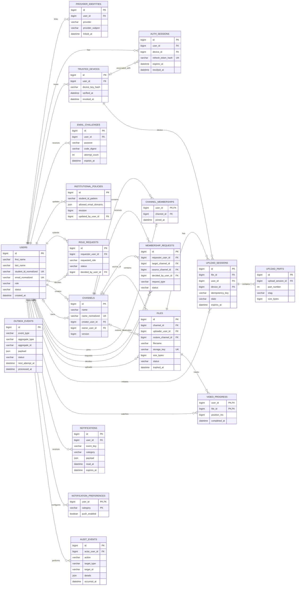
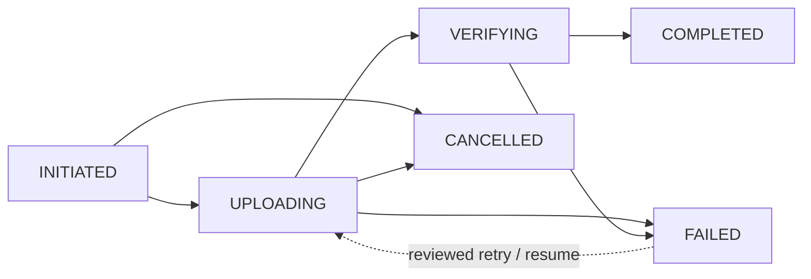

# UniSpace — B2 Database Architecture & Physical Schema

**Document ID:** B2  
**Version:** v1.0 — consolidated design baseline  
**Date:** 22 November 2026  
**Scope:** UniSpace MVP backend (Java 21, Spring Boot, MySQL, private Cloudflare R2)  
**Approval:** Logical model, physical-schema *proposal*, unified ERD, database conventions, Flyway strategy, TDD approach, and concurrency principles **approved by the product owner during B2 review**.  
**Engineering status:** **DESIGN ONLY**. No claim that MySQL tables, migrations, Java entities, constraints, or verification tests have been created or executed. **Sections 8–10 are required implementation-review gates before accepting a production-ready `V1__initial_schema.sql`.**

> **Do not infer implemented from approved.** This document is authoritative as the current **approved B2 design baseline**, subject to the named physical-integrity review gates. Where a gate is marked **OPEN**, do not silently choose a final solution, change approved product behavior, or report the schema as validated.

## 1. Design basis and source hierarchy

Use together with:

1. **Functional Requirements v1.5** — FR-001–137 and **FR Addendum v1.0** — FR-138–167 (167 total: **150 MVP, 17 post-MVP**).
2. **Information Architecture v1.0 + approved IA Addendum v1.0**.
3. **User Flows & Journeys v1.0** (67 original stable flow IDs) **+ approved User Flows Addendum v1.1** (four additional journeys, 21 amendments, two system-level acceptance rules).
4. **Non-Functional Requirements v1.0** (42 objectives).
5. **B0-01 Requirements Traceability Matrix v0.2.1** (the Excel workbook remains the FR traceability source), **B0-02 Module Ownership v0.1.1**, **B0-03 Transactions & Concurrency**, **B0-04 Technical Risk Register**.
6. **B1_Backend_Architecture_v1.0.md** — approved modular-monolith, transaction/outbox, module-boundary and security principles.

The old Backend Engineering Starter Pack is a **historical technical draft**, not a competing approved physical schema. Post-MVP Google Drive features (FR-090–100, FR-150–151), Admin monitoring/audit explorer UI (FR-105–107), and enhanced PDF reader (FR-163) are intentionally excluded from these MVP tables except for any reusable core audit data.

## 2. Approved architecture and physical conventions

| Aspect | B2 design baseline | Notes for implementation |
|---|---|---|
| RDBMS | MySQL 8.x with InnoDB | Verify exact supported server version before Flyway SQL. |
| Logical data authority | MySQL | R2 contains private file bytes, not membership/authorization decisions. |
| Identifier naming | `snake_case` | Table and column names lowercase. |
| Primary keys | `BIGINT UNSIGNED` with generated identity where appropriate | Java `Long` is signed: ensure IDs stay in its representable range or explicitly revisit mapping. |
| Text charset | `utf8mb4` | Choose appropriate, explicit collation for case-insensitive display-name matching and case-sensitive provider subjects/keys. |
| Timestamps | UTC `DATETIME(6)` | Java clock/driver timezone and timestamp semantics must be tested. |
| General length conventions | Names `VARCHAR(100)`; email `VARCHAR(254)`; Student ID `VARCHAR(64)`; filenames `VARCHAR(255)`; status `VARCHAR(32)` | Exceptions are specified per table. |
| Foreign keys | Explicit FKs, primarily `RESTRICT` / `NO ACTION` | No broad destructive cascades; explicit part-row cleanup is an exception. |
| Schema evolution | Flyway versioned SQL | Hibernate `ddl-auto: validate`; do not use `update` as schema manager. |
| Transaction policy | MySQL InnoDB; `REPEATABLE READ` as baseline; critical locking reads (`FOR UPDATE`) | Do not use stale snapshot reads for capacity, owner, last-Admin, or delete decisions. |
| Async follow-up | DB-backed transactional outbox + idempotent workers | No Kafka/RabbitMQ/Redis requirement for the initial pilot. |
| Verification method | TDD, JUnit 5, Mockito, Spring Security Test, Testcontainers + real MySQL | H2 is not required. |
| Central media | Private Cloudflare R2 | `files` holds metadata/object references, not media bytes. |

**Auth implementation direction selected for B3:** UniSpace-issued short-lived signed **JWT access tokens** plus rotating opaque refresh tokens tracked with hashed credentials in MySQL `auth_sessions`. Device trust is distinct from session/token expiry. **B3** must still design refresh replay handling, precise expiry and immediate revocation behavior.

## 3. Table inventory (18 core MVP tables)

| Group | Tables | Count |
|---|---|---:|
| Identity & Authentication | `users`, `provider_identities`, `auth_sessions`, `trusted_devices`, `email_challenges` | 5 |
| Administration & Policy | `institutional_policies`, `role_requests` | 2 |
| Channels & Membership | `channels`, `channel_memberships`, `membership_requests` | 3 |
| Media, Uploads & Files | `files`, `upload_sessions`, `upload_parts`, `video_progress` | 4 |
| Notifications, Audit & Outbox | `notifications`, `notification_preferences`, `audit_events`, `outbox_events` | 4 |
| **Total** | | **18** |

**The count is a design baseline, not a rule that prohibits a justified additional table** (e.g., refresh-token replay history, external delivery-attempt ledger, idempotency ledger, or media deletion tombstone). An additional table needs a documented rationale and review; never silently change the approved product behavior.

## 4. One unified Mermaid ER diagram

This is the user-approved unified **18-table relationship view**. It intentionally displays the principal keys and selected columns to remain readable. Column details and index/constraint requirements are in Section 5. **The Mermaid lines describe conceptual FK relationships, not proof that every MySQL FK is feasible as drawn.** `outbox_events` is standalone because it stores aggregate references in fields/payload rather than hard FKs to every aggregate.



### ERD relationship notes

- An occupied channel must have **one current owner who is a current member**; a 0/6 channel has `owner_user_id = NULL`. Creator identity is historical and **does not automatically confer current ownership**.
- A student has **at most one current channel membership**, and channel admission must never exceed **six** active student members.
- `membership_requests` has **two distinct channel relationships** (target/source) and optional decision-maker; detailed FK deletion policy must preserve historical decisions.
- `files` has a present channel and an optional **last channel before Trash** (`restore_channel_id`), in addition to immutable original uploader attribution.
- `video_progress` is a `(user_id, file_id)` join entity; it does not grant access to the underlying file.
- `outbox_events` references business aggregates by event type + stable ID, without broad cross-module FKs.

## 5. Detailed proposed physical tables

Conventions in tables: **PK** = primary key; **FK** = foreign key; **UK** = unique key; **NN** = not null; **NULL** = nullable. Unless stated otherwise, time columns are `DATETIME(6)` in UTC. Numeric IDs use the approved `BIGINT UNSIGNED` convention. Optional columns must not be interpreted as a relaxation of onboarding, permission or publication requirements.

### 5.1 Identity & Authentication

#### `users`

| Column | MySQL type | Null | Notes / keys |
|---|---|---|---|
| `id` | `BIGINT UNSIGNED` | NN | **PK**, generated ID |
| `first_name` | `VARCHAR(100)` | NULL | May be absent during provisional registration |
| `last_name` | `VARCHAR(100)` | NULL | Same |
| `student_id` | `VARCHAR(64)` | NULL | Original/display form; provisional nullable |
| `student_id_normalized` | `VARCHAR(64)` | NULL | **UK**; normalize consistently with current policy |
| `university_email` | `VARCHAR(254)` | NULL | Provisional nullable |
| `email_normalized` | `VARCHAR(254)` | NULL | **UK** for verified institutional identity |
| `email_verified_at` | `DATETIME(6)` | NULL | Set only after valid OTP ownership proof |
| `role` | `VARCHAR(32)` | NN | `STUDENT`, `SUB_MANAGEMENT`, `MANAGEMENT`, `ADMIN` |
| `status` | `VARCHAR(32)` | NN | `PENDING_PROFILE`, `PENDING_EMAIL_VERIFICATION`, `ACTIVE`, `DISABLED` |
| `created_at` | `DATETIME(6)` | NN | UTC |
| `updated_at` | `DATETIME(6)` | NN | UTC |

**Keys / behavior:** unique normalized Student ID and email (MySQL permits multiple `NULL`s in unique indexes); registration must atomically validate policy and uniqueness; do not grant ACTIVE access without verified email. Protect the last active ADMIN by serialized role-change logic. **Review gate:** define when provisional emails/Student IDs are reserved and what happens to abandoned registrations, without allowing duplicates or invalidating existing ACTIVE accounts.

#### `provider_identities`

| Column | MySQL type | Null | Notes / keys |
|---|---|---|---|
| `id` | `BIGINT UNSIGNED` | NN | **PK** |
| `user_id` | `BIGINT UNSIGNED` | NN | **FK** → `users.id` |
| `provider` | `VARCHAR(16)` | NN | Google/Apple; validated allowed values |
| `provider_subject` | `VARCHAR(255)` | NN | Immutable provider subject; **case-sensitive** comparison |
| `linked_at` | `DATETIME(6)` | NN | UTC |

**UK:** `(provider, provider_subject)`; `(user_id, provider)`. Never link/merge UniSpace users on email equality. Link proof and uniqueness must be checked in one atomic transaction.

#### `trusted_devices`

| Column | MySQL type | Null | Notes / keys |
|---|---|---|---|
| `id` | `BIGINT UNSIGNED` | NN | **PK** |
| `user_id` | `BIGINT UNSIGNED` | NN | **FK** → `users.id` |
| `device_key_hash` | `CHAR(64)` | NN | Secure device-binding identifier representation |
| `verified_at` | `DATETIME(6)` | NN | Trust establishment |
| `last_seen_at` | `DATETIME(6)` | NULL | Informational |
| `revoked_at` | `DATETIME(6)` | NULL | Trust terminated on sign-out/revoke/security event |

**UK:** `(user_id, device_key_hash)`. **B3 gate:** define secure device binding and identity to prevent spoofing; trust does not override token/session expiry.

#### `auth_sessions`

| Column | MySQL type | Null | Notes / keys |
|---|---|---|---|
| `id` | `BIGINT UNSIGNED` | NN | **PK** |
| `user_id` | `BIGINT UNSIGNED` | NN | **FK** → `users.id` |
| `device_id` | `BIGINT UNSIGNED` | NULL | **FK** → `trusted_devices.id`; null only under reviewed issuance policy |
| `refresh_token_hash` | `CHAR(64)` | NN | **UK**; hash of rotating opaque refresh token |
| `created_at` | `DATETIME(6)` | NN | UTC |
| `last_refreshed_at` | `DATETIME(6)` | NULL | UTC |
| `expires_at` | `DATETIME(6)` | NN | JWT access lifetime is **separate** |
| `revoked_at` | `DATETIME(6)` | NULL | Session revocation |

**B3 gate:** one row with a current hash is not by itself a complete **refresh-token rotation/reuse-detection** design. Determine whether an additional token-family/replay ledger is needed; also verify `device_id` belongs to the same user (basic independent FKs do not prove this).

#### `email_challenges`

| Column | MySQL type | Null | Notes / keys |
|---|---|---|---|
| `id` | `BIGINT UNSIGNED` | NN | **PK** |
| `user_id` | `BIGINT UNSIGNED` | NN | **FK** → `users.id` |
| `purpose` | `VARCHAR(32)` | NN | Registration / new-device verification |
| `destination_email` | `VARCHAR(254)` | NN | Address to which challenge was sent |
| `code_digest` | `VARBINARY(32)` | NN | Keyed digest, not plaintext OTP |
| `attempt_count` | `TINYINT UNSIGNED` | NN | Starts at zero; max five invalid attempts |
| `created_at` | `DATETIME(6)` | NN | UTC |
| `expires_at` | `DATETIME(6)` | NN | Ten-minute validity |
| `resend_available_at` | `DATETIME(6)` | NN | 60-second resend boundary |
| `consumed_at` | `DATETIME(6)` | NULL | Single-use record |
| `invalidated_at` | `DATETIME(6)` | NULL | Replacement/failed-attempt invalidation |

**Indexes proposed:** `(user_id, purpose, created_at)`; expiry cleanup as needed. Atomic challenge consumption is required; a previous code must fail after replacement. **B3 gate:** keyed digest secret rotation and OTP anti-abuse policy.

### 5.2 Administration & Policy

#### `institutional_policies`

| Column | MySQL type | Null | Notes / keys |
|---|---|---|---|
| `id` | `BIGINT UNSIGNED` | NN | **PK** |
| `student_id_pattern` | `VARCHAR(512)` | NN | Admin-managed validation rule |
| `allowed_email_domains` | `JSON` | NN | Permitted institutional domains |
| `revision` | `BIGINT UNSIGNED` | NN | Optimistic concurrency/version |
| `updated_by_user_id` | `BIGINT UNSIGNED` | NN | **FK** → `users.id` |
| `updated_at` | `DATETIME(6)` | NN | UTC |

**Policy:** one active policy row proposed; changes apply to future registrations only, never retroactively invalidate existing ACTIVE users. Atomic edit/version check; record actor/action in immutable audit. **Review gate:** how to seed the first valid policy, and whether history is audit-only or additionally versioned policy snapshots.

#### `role_requests`

| Column | MySQL type | Null | Notes / keys |
|---|---|---|---|
| `id` | `BIGINT UNSIGNED` | NN | **PK** |
| `requester_user_id` | `BIGINT UNSIGNED` | NN | **FK** → `users.id` |
| `requested_role` | `VARCHAR(32)` | NN | Only permitted requestable staff roles |
| `status` | `VARCHAR(32)` | NN | Proposed: `PENDING`, `APPROVED`, `REJECTED` |
| `decided_by_user_id` | `BIGINT UNSIGNED` | NULL | **FK** → `users.id` |
| `decision_note` | `VARCHAR(500)` | NULL | Optional, must avoid sensitive data |
| `created_at` | `DATETIME(6)` | NN | UTC |
| `decided_at` | `DATETIME(6)` | NULL | UTC |

**Indexes:** `(status, created_at)`; `(requester_user_id, created_at)`. Student-to-staff transition must complete channel exit/owner succession prerequisites atomically; avoid duplicate/conflicting decisions. **Review gate:** pending-request deduplication/resubmission policy.

### 5.3 Channels & Membership

#### `channels`

| Column | MySQL type | Null | Notes / keys |
|---|---|---|---|
| `id` | `BIGINT UNSIGNED` | NN | **PK** |
| `name` | `VARCHAR(120)` | NN | Human-readable channel name |
| `name_normalized` | `VARCHAR(120)` | NN | **UK**; trim + case-fold consistently |
| `creator_user_id` | `BIGINT UNSIGNED` | NN | **FK** → `users.id`; historical creator |
| `owner_user_id` | `BIGINT UNSIGNED` | NULL | **FK** → `users.id`; **NULL** at 0/6 |
| `version` | `BIGINT UNSIGNED` | NN | Concurrency/version marker |
| `created_at` | `DATETIME(6)` | NN | UTC |
| `updated_at` | `DATETIME(6)` | NN | UTC |

**Requirements:** retained and discoverable at 0/6; Admin-only rename/delete; case-insensitive unique names; creator joins/owns upon creation; first approved entrant to empty channel becomes owner. **Mandatory gate:** a simple `owner_user_id` FK ensures that a user exists, **not** that they belong to that channel; enforce active-owner membership with transaction protocol and investigate composite-FK feasibility/cyclic DDL before implementation.

#### `channel_memberships`

| Column | MySQL type | Null | Notes / keys |
|---|---|---|---|
| `user_id` | `BIGINT UNSIGNED` | NN | **PK + FK** → `users.id` |
| `channel_id` | `BIGINT UNSIGNED` | NN | **FK** → `channels.id` |
| `joined_at` | `DATETIME(6)` | NN | UTC |

**Index:** `(channel_id, user_id)` for roster and optional composite owner constraint. One row/student guarantees one current active channel. No soft/inactive membership rows in this table; history lives in audit/events. Channel-row locking + capacity check enforces maximum six; the DB unique key alone **does not** enforce that count.

#### `membership_requests`

| Column | MySQL type | Null | Notes / keys |
|---|---|---|---|
| `id` | `BIGINT UNSIGNED` | NN | **PK** |
| `requester_user_id` | `BIGINT UNSIGNED` | NN | **FK** → `users.id` |
| `target_channel_id` | `BIGINT UNSIGNED` | NN | **FK** → `channels.id` in initial model; **OPEN deletion-history gate** |
| `source_channel_id` | `BIGINT UNSIGNED` | NULL | **FK** → `channels.id` in initial model; **OPEN deletion-history gate** |
| `request_type` | `VARCHAR(16)` | NN | Proposed `JOIN` / `SWITCH` |
| `status` | `VARCHAR(32)` | NN | Proposed `PENDING`, `APPROVED`, `REJECTED`, `CANCELLED` |
| `requested_at` | `DATETIME(6)` | NN | UTC |
| `decided_by_user_id` | `BIGINT UNSIGNED` | NULL | **FK** → `users.id` |
| `decided_at` | `DATETIME(6)` | NULL | UTC |

**Indexes:** `(target_channel_id, status, requested_at)` and `(requester_user_id, status)`. **Conditional UK required** so one requester cannot hold duplicate pending requests to the same channel, while preserving history (e.g., a generated key set to target only while `PENDING`). Empty-channel Admin approvals are one shared pending decision; owner approves occupied-channel requests. **Critical gate:** eligible channel deletion cancels pending requests and preserves decision history; `RESTRICT` FKs to historical request rows would block deletion. Choose a safe reference-archival/detachment strategy in Section 8.

### 5.4 Media, Uploads & Files

#### `files`

| Column | MySQL type | Null | Notes / keys |
|---|---|---|---|
| `id` | `BIGINT UNSIGNED` | NN | **PK** |
| `channel_id` | `BIGINT UNSIGNED` | NN | **FK** → `channels.id` while active/trashed; **OPEN tombstone gate** |
| `uploader_user_id` | `BIGINT UNSIGNED` | NN | **FK** → `users.id`; original uploader immutable |
| `filename` | `VARCHAR(255)` | NN | Display filename |
| `filename_normalized` | `VARCHAR(255)` | NN | Normalized for collision-safe uniqueness |
| `file_category` | `VARCHAR(16)` | NN | Video / PDF / PPT-PPTX classification |
| `mime_type` | `VARCHAR(128)` | NN | Type checked; never trust extension alone |
| `size_bytes` | `BIGINT UNSIGNED` | NULL | Unknown before verified upload |
| `storage_key` | `VARCHAR(512)` | NULL | **UK** if populated; private R2 object key |
| `duration_ms` | `BIGINT UNSIGNED` | NULL | Video metadata when known |
| `status` | `VARCHAR(32)` | NN | `PENDING`, `PROCESSING`, `ACTIVE`, `TRASHED`, `DELETED` (see §6) |
| `restore_channel_id` | `BIGINT UNSIGNED` | NULL | **FK** → `channels.id`; last channel before Trash |
| `created_at` | `DATETIME(6)` | NN | UTC |
| `updated_at` | `DATETIME(6)` | NN | UTC |
| `published_at` | `DATETIME(6)` | NULL | After safety/integrity verification |
| `trashed_at` | `DATETIME(6)` | NULL | Start of 30-day retention |
| `deleted_at` | `DATETIME(6)` | NULL | Permanent-delete transition marker |

**Indexes:** `(channel_id, status, created_at)`; `(channel_id, status, filename_normalized)`; `(channel_id, status, size_bytes)`; `storage_key` unique/case-sensitive representation. **Active filename constraint:** unique normalized filename for ACTIVE rows within a channel, with Trash names not blocking re-use; MySQL generated-column approach is illustrated in §7. Upload/move/rename must append numbered suffix without overwriting other records. Files are not public until verified safe. **Review gate:** file tombstones, storage-key cleanup, user attribution, channel-deletion eligibility and optional `restore_channel_id` references must be reconciled; never allow cleanup to delete the channel automatically.

#### `upload_sessions`

| Column | MySQL type | Null | Notes / keys |
|---|---|---|---|
| `id` | `BIGINT UNSIGNED` | NN | **PK** |
| `file_id` | `BIGINT UNSIGNED` | NN | **FK** → `files.id` |
| `user_id` | `BIGINT UNSIGNED` | NN | **FK** → `users.id` |
| `device_id` | `BIGINT UNSIGNED` | NN | **FK** → `trusted_devices.id` in draft; **OPEN** if upload can occur without trusted-device record |
| `storage_upload_id` | `VARCHAR(255)` | NULL | R2 multipart upload identifier |
| `idempotency_key` | `VARCHAR(100)` | NN | Client/server retry identifier |
| `state` | `VARCHAR(32)` | NN | See §6 |
| `created_at` | `DATETIME(6)` | NN | UTC |
| `updated_at` | `DATETIME(6)` | NN | UTC |
| `expires_at` | `DATETIME(6)` | NULL | Abandoned session policy |
| `completed_at` | `DATETIME(6)` | NULL | UTC |

**UK:** `(user_id, idempotency_key)`. **Indexes:** `(device_id, state)`; `(state, expires_at)`. Max three active transfers **per device** while app active; queued uploads may be a Flutter-owned scheduler. Persist enough server metadata for resumability and reconcile interrupted/missing sources. **Review gate:** device/session identification and whether additional queued/rejected states are necessary; do not confuse an upload's session state with its file-publication state.

#### `upload_parts`

| Column | MySQL type | Null | Notes / keys |
|---|---|---|---|
| `id` | `BIGINT UNSIGNED` | NN | **PK** |
| `upload_session_id` | `BIGINT UNSIGNED` | NN | **FK** → `upload_sessions.id` |
| `part_number` | `INT UNSIGNED` | NN | R2 multipart part number |
| `etag` | `VARCHAR(255)` | NN | Object-store completion identifier |
| `size_bytes` | `BIGINT UNSIGNED` | NN | Part size |
| `uploaded_at` | `DATETIME(6)` | NN | UTC |

**UK:** `(upload_session_id, part_number)`. **Delete:** `ON DELETE CASCADE` may be used **only** when deliberately cleaning up an upload session and its dependent part records; remote multipart abort is a separate idempotent external operation.

#### `video_progress`

| Column | MySQL type | Null | Notes / keys |
|---|---|---|---|
| `user_id` | `BIGINT UNSIGNED` | NN | **Composite PK + FK** → `users.id` |
| `file_id` | `BIGINT UNSIGNED` | NN | **Composite PK + FK** → `files.id` |
| `position_ms` | `BIGINT UNSIGNED` | NN | Last playback position |
| `completed_at` | `DATETIME(6)` | NULL | Playback-completion marker |
| `updated_at` | `DATETIME(6)` | NN | UTC |

**PK:** `(user_id, file_id)`. Progress per user/video; completed playback restarts from beginning. Saving playback progress never confers file authorization.

### 5.5 Notifications, Audit & Outbox

#### `notifications`

| Column | MySQL type | Null | Notes / keys |
|---|---|---|---|
| `id` | `BIGINT UNSIGNED` | NN | **PK** |
| `user_id` | `BIGINT UNSIGNED` | NN | **FK** → `users.id` |
| `event_key` | `VARCHAR(128)` | NN | Stable idempotent delivery key |
| `category` | `VARCHAR(32)` | NN | Category preferences |
| `notification_type` | `VARCHAR(64)` | NN | Rendered event class |
| `payload` | `JSON` | NN | Display/target metadata, no secrets |
| `created_at` | `DATETIME(6)` | NN | UTC |
| `read_at` | `DATETIME(6)` | NULL | Inbox read state |
| `deleted_at` | `DATETIME(6)` | NULL | User deletion from inbox |
| `expires_at` | `DATETIME(6)` | NN | 90-day policy |

**UK:** `(user_id, event_key)`. **Indexes:** `(user_id, deleted_at, created_at)`; `(user_id, read_at)`. Always create required in-app records independent of optional push preferences; on link-open, recheck current permission.

#### `notification_preferences`

| Column | MySQL type | Null | Notes / keys |
|---|---|---|---|
| `user_id` | `BIGINT UNSIGNED` | NN | **Composite PK + FK** → `users.id` |
| `category` | `VARCHAR(32)` | NN | **Composite PK**; channel requests, role updates, file activities, general announcements |
| `push_enabled` | `BOOLEAN` | NN | Toggle affects optional push only |
| `updated_at` | `DATETIME(6)` | NN | UTC |

**PK:** `(user_id, category)`.

#### `audit_events`

| Column | MySQL type | Null | Notes / keys |
|---|---|---|---|
| `id` | `BIGINT UNSIGNED` | NN | **PK** |
| `actor_user_id` | `BIGINT UNSIGNED` | NULL | **FK** → `users.id` if resolvable; system actions may have no user |
| `action` | `VARCHAR(100)` | NN | Immutable event/action name |
| `target_type` | `VARCHAR(64)` | NN | Stable logical target type |
| `target_id` | `VARCHAR(64)` | NULL | String identifier/snapshot; not FK to each resource |
| `details` | `JSON` | NN | Allowlisted safe metadata; **no secrets** |
| `correlation_id` | `VARCHAR(64)` | NULL | Request/event correlation |
| `occurred_at` | `DATETIME(6)` | NN | UTC |
| `retention_until` | `DATETIME(6)` | NN | 365-day policy, unless overriding retention requirement |

**Indexes:** `(actor_user_id, occurred_at)`; `(target_type, target_id)`; `(retention_until)`. Required audit write commits with the protected business mutation; do not defer required audit capture to an unreliable post-commit callback. **Review gate:** actor-account deletion and historical audit retention must be consistent. The Admin audit explorer UI is post-MVP.

#### `outbox_events`

| Column | MySQL type | Null | Notes / keys |
|---|---|---|---|
| `id` | `BIGINT UNSIGNED` | NN | **PK** |
| `event_type` | `VARCHAR(100)` | NN | Explicit versioned event contract |
| `aggregate_type` | `VARCHAR(64)` | NN | Source domain aggregate kind |
| `aggregate_id` | `VARCHAR(64)` | NN | Source ID as stable string |
| `event_version` | `SMALLINT UNSIGNED` | NN | Event payload version |
| `payload` | `JSON` | NN | Non-secret business identifiers/data |
| `status` | `VARCHAR(32)` | NN | Proposed: `PENDING`, `PROCESSING`, `DONE`, `FAILED` |
| `attempt_count` | `INT UNSIGNED` | NN | Retry count |
| `next_attempt_at` | `DATETIME(6)` | NN | Due time for dispatch/retry |
| `claimed_by` | `VARCHAR(100)` | NULL | Worker lease owner |
| `claim_expires_at` | `DATETIME(6)` | NULL | Lease recovery |
| `deduplication_key` | `VARCHAR(128)` | NULL | Optional **UK** |
| `created_at` | `DATETIME(6)` | NN | UTC |
| `processed_at` | `DATETIME(6)` | NULL | UTC |

**Indexes:** `(status, next_attempt_at, id)`; `(status, claim_expires_at)`. The outbox row and required audit are written in the **same MySQL transaction** as the committed business change. A worker may process events at least once; consumers must be idempotent. Failed push delivery does not undo a successful membership or role change. **Review gate:** record successful in-app notification creation separately from optional push retries, so a push failure does not repeatedly create the same inbox item.

## 6. Lifecycle states, transitions and retention

### 6.1 Account states (approved functional behavior)

| State | Meaning |
|---|---|
| `PENDING_PROFILE` | Provider identified; required profile/Student ID incomplete |
| `PENDING_EMAIL_VERIFICATION` | Profile captured; university email not verified |
| `ACTIVE` | Eligible for role- and resource-authorized access |
| `DISABLED` | Account access disabled |

### 6.2 Upload-session state design (approved as initial technical baseline)



**Guards:** only valid, authorized, complete and safely verified uploads may become published files. Neither `FAILED` nor `CANCELLED` publishes content. Support interrupted-upload recovery without guaranteeing transfer while the application is closed. **Review gate:** expiration/abandonment state and the exact failed→retry sequence; server state is not a substitute for Flutter's three-active-upload device queue.

### 6.3 File lifecycle (approved as initial technical baseline)


**Guards:** actual data publication requires both upload completion and safety verification. Invalid/incomplete files are never `ACTIVE`. A failed upload may leave a non-public file/session record requiring safe cleanup. `TRASHED` objects are hidden from normal libraries and must be removed no later than 30 days after entering Trash unless superseded by applicable obligations. Restore requires current permission and returns to the *last* channel before Trash. Permanent deletion bypasses recovery; remote R2 deletion cannot be included in an ordinary MySQL transaction.

### 6.4 Retention and data handling

| Record | Policy | Storage consideration |
|---|---|---|
| Trash files | Up to 30 days after trash time | Preserve last-channel link until restore or permanent deletion; reconcile R2 cleanup. |
| In-app notifications | 90 days; individual delete/read/mark-all | Expiry job; deleting notification does not undo underlying action or audit. |
| Audit events | 365 days unless legal/institutional duty overrides | Append-only logical policy, no OTP/token/password or other authentication secrets. |
| Exported device files | Beyond UniSpace's remote control | Android Downloads/iOS Files copies are user-owned after export; cannot promise revocation. |
| Trusted-device status | No fixed 30/90-day expiry | Ends on sign-out/revocation/security event, distinct from token/session validity. |

## 7. Key constraints, indexes and physical examples

### 7.1 Minimum required relational constraints

| Invariant | SQL/transaction mechanism | Acceptance requirement |
|---|---|---|
| Single provider identity assignment | `UNIQUE(provider, provider_subject)`; verified provider proof | No identity linked to two users, including concurrent attempts (FR-167). |
| One current channel per student | `channel_memberships.user_id` **PK** | Never two active memberships, even under switch/approval races (FR-018, 028). |
| Up to six members | Lock channel row, recheck count and membership before insert | Never 7/6 (FR-019, 024). |
| Owner always current member if occupied | Channels transaction invariants; composite-FK option reviewed separately | No ownerless 1–6/6 channel, no owner who left (FR-138,139,166). |
| Unique case-insensitive channel name | `UNIQUE(name_normalized)` | Trimming/case variants cannot collide (FR-015, 035). |
| One pending request per user/target | Conditional unique key for pending target | Retry cannot create duplicate pending request (FR-025). |
| Unique active filename per channel | Conditional generated-column unique key; suffix allocation/retry | `Lecture.pdf`, `Lecture (1).pdf`, etc.; never overwrite (FR-147). |
| Idempotent upload-initiation retry | `UNIQUE(user_id, idempotency_key)` | Repeated request yields one logical session (NFR safe retries). |
| Multipart part identity | `UNIQUE(upload_session_id, part_number)` | Retry cannot duplicate a part entry. |
| Video position uniqueness | PK `(user_id, file_id)` | No cross-user or cross-video leakage (FR-159). |
| Notification deduplication | `UNIQUE(user_id, event_key)` | At-least-once worker doesn't duplicate inbox entries. |
| Outbox event deduplication | Optional `UNIQUE(deduplication_key)`, lease and idempotent handler | Retry safe with no duplicate domain mutation. |

### 7.2 Example: conditional ACTIVE-filename uniqueness (illustrative, not final DDL)

```sql
-- Conceptual MySQL generated-column expression inside CREATE TABLE files:
active_name_key VARCHAR(255)
  GENERATED ALWAYS AS (
    CASE WHEN status = 'ACTIVE' THEN filename_normalized ELSE NULL END
  ) STORED,
UNIQUE KEY uq_files_active_name (channel_id, active_name_key)
```

MySQL allows multiple `NULL` values in a unique index. Thus non-ACTIVE rows do not reserve active names. **Review before migration:** if filenames can exceed the selected collation/index byte constraints, use a reviewed character limit/normalization policy. All rename, move, restore and publish flows must preserve uniqueness; in particular, a restore may need the approved numbered-suffix rule when its old active name has been reused.

### 7.3 Example: conditional pending-request uniqueness (illustrative)

```sql
-- Requires review against final request lifecycle:
pending_target_id BIGINT UNSIGNED
  GENERATED ALWAYS AS (
    CASE WHEN status = 'PENDING' THEN target_channel_id ELSE NULL END
  ) STORED,
UNIQUE KEY uq_pending_request_target (requester_user_id, pending_target_id)
```

This implements **no duplicate PENDING requests to the same destination** while allowing previously decided request history. Whether there may be multiple PENDING requests across different destinations is a distinct approved-flow interpretation, not silently constrained here.

### 7.4 Proposed query-driven indexes

| Table | Candidate index | Query served |
|---|---|---|
| `channels` | `UNIQUE(name_normalized)` and/or `(name_normalized, id)` | Channel name uniqueness and prefix discovery; avoid redundant duplicates. |
| `channel_memberships` | `(channel_id, user_id)` | Rosters, capacity checks and owner verification. |
| `membership_requests` | `(target_channel_id, status, requested_at)` | Owner/Admin approval queue. |
| `membership_requests` | `(requester_user_id, status)` | My request status. |
| `files` | `(channel_id, status, created_at)` | Recent files. |
| `files` | `(channel_id, status, filename_normalized)` | Name sorting/prefix search. |
| `files` | `(channel_id, status, size_bytes)` | File-size sorting. |
| `notifications` | `(user_id, deleted_at, created_at)` | Visible inbox. |
| `notifications` | `(user_id, read_at)` | Unread entries/count. |
| `audit_events` | `(target_type, target_id)` and `(retention_until)` | Safe audit reference and retention cleanup. |
| `outbox_events` | `(status, next_attempt_at, id)`; `(status, claim_expires_at)` | Pending and abandoned-lease claims. |

Do **not** add every candidate index blindly. Some are covered by UNIQUE/PK prefixes; validate query plans (`EXPLAIN`), realistic data, collation and sorting direction. B-tree indexes do not provide arbitrary substring search; if FR-057 needs substring matching, specify a tested query/search strategy rather than pretending an ordinary prefix index suffices.

## 8. Mandatory physical-integrity review gates — OPEN before executable DDL

These are the unresolved **engineering details**, not new user-feature decisions. B2 design approval **does not** mark them implemented. Any chosen strategy must preserve the controlling FRs.

| ID | Open engineering question | Required design/verification outcome |
|---|---|---|
| **DB-G01** | **Owner membership integrity:** `channels.owner_user_id → users.id` alone permits a nonmember owner. A composite FK `(owner_user_id, channel_id) → channel_memberships(user_id, channel_id)` may create an intentional FK cycle. | Select safe FK/transaction strategy; test creation, first join 0/6, voluntary leave/switch, forced owner removal, last member exit, concurrent changes and channel deletion. Never publish occupied channel without one member owner. |
| **DB-G02** | **Channel deletion vs. membership-request history:** historical `membership_requests.target_channel_id` or `source_channel_id` FKs with `RESTRICT` would block deletion despite zero members/files/Trash. | Choose explicit snapshot + nullable FK/detach, or archival strategy that retains historical decisions and audit, atomically cancels pending requests and allows eligible Admin deletion. **No unreviewed cascade of request history.** |
| **DB-G03** | **Permanent file deletion vs. channel eligibility:** `files.status='DELETED'` with `files.channel_id` FK could block eligible channel deletion; removal of R2 object can fail after DB commit. | Define tombstone/archival or removal state with safe retry and reconciliation. Ensure `0 active + 0 Trash` means exactly the approved channel deletion condition; protect failed/in-flight uploads before deletion. Never leave a recoverable file after confirmed permanent deletion. |
| **DB-G04** | **Restore collision and destination:** a trashed file's last channel may be gone/unauthorized; its old filename may have been reused. | Deny invalid restore without implicit alternate destination; for valid restoration apply collision-safe suffix without changing file ID or original uploader. |
| **DB-G05** | **FK delete effects for user/account records and audit:** hard delete may conflict with uploader attribution and actor audit history. | Preserve attribution/audit per approved policy; select user disable/anonymization/hard-delete lifecycle and FK behaviors only after privacy/security review. |
| **DB-G06** | **Refresh token rotation and replay:** one `auth_sessions.refresh_token_hash` cannot alone show all previously rotated token reuse. | B3 decides token family/history strategy, session revocation and prompt protection against stale JWT permissions; add table/columns if needed. |
| **DB-G07** | **Device linkage and upload concurrency:** `upload_sessions.device_id` is NN FK to `trusted_devices`, which may be too strict and can mismatch `upload_sessions.user_id`. | Decide secure device identifier, trust requirement, user/device consistency and exactly where the three-active-uploads-per-device queue is enforced. |
| **DB-G08** | **Data type/collation/JPA alignment:** unsigned BIGINT vs Java signed Long, Unicode index widths, provider-subject case sensitivity, nullable unique fields and JSON mapping. | Run clean MySQL+Flyway+Hibernate validation and edge-case tests; choose collation and Java mapping deliberately. |
| **DB-G09** | **Retention & worker failure recovery:** MySQL audit/notification expiry, upload abandonment and R2 orphan objects involve multiple systems. | Define idempotent jobs, outbox lease/attempt behavior, alerting for stuck work, and recovery without bypassing authorization. |
| **DB-G10** | **Complete DDL detail:** full defaults, `CHECK`s or validated enum policy, FK names and `ON DELETE` behavior, initial Admin/registration-policy provisioning, timestamp definitions, index ordering. | Review actual generated SQL against all 18 table specifications before calling V1 complete. |

**Gate status:** All **OPEN / implementation verification pending**. They may be resolved in the migration design and focused B3/security/storage designs; do not silently assume their proposed solution is approved just because the 18-table ERD was approved.

## 9. MySQL transactions and concurrency tests (approved approach)

Use InnoDB transactions around business decisions, `SELECT ... FOR UPDATE` or equivalent for critical rows, consistent lock ordering and bounded idempotent retries on deadlock/conflict. **No R2/email/push network calls while holding a business transaction.** Store required audit record and outbox event in the same transaction as the state change.

| Critical use case | Minimum transactional verification |
|---|---|
| Channel creation | Normalized-name UK, eligible student unique membership, creator becomes initial owner in one commit. |
| Two approvals for last seat | Channel row lock; only one succeeds; final count never exceeds 6. |
| Two Admins deciding 0/6 join | One request decision; first admitted student becomes owner; all Admins' notices are not separate approvals. |
| Student pending switch | Source membership retained until destination approval; atomic switch, never two memberships. |
| Owner departure/removal | Validate active successor; transfer + membership removal atomic; empty channel has null owner. |
| Staff promotion | Membership/owner prerequisites resolved before role transition; role and membership remain consistent. |
| Last-Admin protection | Concurrent demotions cannot leave zero functioning Admins. |
| Channel deletion | Serialize with membership/file mutations; recheck 0 active members, 0 active files and 0 Trash; cancel requests and audit. |
| Upload finalization | Safe, verified object only; publish once, no duplicate name or partial file exposure. |
| Trash restore | Last-channel destination and current access rechecked; collision-safe rename. |
| Permanent delete | Retry/reconcile R2 operation, do not misreport completed deletion or leave recoverable state. |
| Outbox dispatch | Crash after commit or mid-delivery does not lose required event or duplicate in-app notification. |

Transactions ensure MySQL atomicity, not cross-service atomicity with R2. A durable outbox coordinates eventual work. Maintain separate, tested authorization enforcement for every download, playback, file/Trash operation and role mutation.

## 10. Flyway + TDD implementation handoff

### 10.1 Migration plan (approved strategy, not generated DDL)

Either one initial migration or several ordered initial migrations is technically possible. The accepted plan favors a **single initial DDL migration** after all FK and constraint dependencies have been resolved, then new files for future changes:

```text
src/main/resources/db/migration/
├── V1__initial_schema.sql           # Proposed future: creates the reviewed 18-table schema
├── V2__some_future_change.sql       # Example only — not yet created
└── V3__another_future_change.sql    # Example only — not yet created
```

A migration may contain many ordinary SQL statements. **Once applied to shared/persistent environments, never edit V1**; add a new versioned migration instead. Flyway checks executed migration history and checksums — **it does not detect all manual MySQL schema drift or ordinary row data changes**. Prefer migration-only schema changes; do not use Hibernate `ddl-auto=update`.

Sample Spring configuration **to implement/test later**, not proof of running setup:

```yaml
spring:
  jpa:
    hibernate:
      ddl-auto: validate
  flyway:
    enabled: true
    clean-disabled: true
```

### 10.2 TDD workflow

1. Read the FR/flow acceptance criteria and identify the domain invariant.
2. Write a failing JUnit/Mockito unit test for a pure rule or a failing **Testcontainers MySQL** integration test for DB behavior/locking/migration.
3. Produce the smallest Flyway/Java implementation that makes the test pass.
4. Refactor with tests green; do not weaken or delete failing tests merely to achieve green.
5. Test fresh migration from an empty MySQL schema and migration-based upgrade from the last supported version.
6. Test unique/FK/constraint enforcement, `REPEATABLE READ` + locking, deadlock retry, idempotency, crashes during outbox/R2 processing and security authorization.
7. Run Spring JPA schema validation against migrated MySQL and inspect query plans for important listing/search operations.
8. Record results and link tests to FRs in B0-01 when implementation starts; unexecuted checks remain pending.

**No H2 dependency is required initially**. Unit tests can use mocks; persistence/concurrency tests should use real MySQL via Testcontainers. Testcontainers requires a supported container runtime; disk usage should be managed deliberately on the development laptop.

## 11. Requirements traceability and scope safeguards

| B2 domain | Primary relevant FRs | Invariants / required behavior |
|---|---|---|
| Identity/registration | FR-002–009, FR-113–137, FR-156, FR-158, FR-167 | Provider uniqueness, provisional registration, verified email/Student ID, OTP limits, trusted device/session separation, secure linking. |
| Administration | FR-005, FR-010–013, FR-101–104, FR-109, FR-112, FR-144, FR-157 | Admin provisioning, last-Admin protection, role requests/changes, institutional rules, staff-channel transition. |
| Channels | FR-014–035, FR-110–111, FR-138–142, FR-166 | One membership, max six, owner transition, empty channels, safe deletion/cancellation, exceptional owner removal. |
| Uploads/media | FR-036–066, FR-145–149, FR-159–162, FR-164–165 | Safe files/private R2, size/type limits, resumability, metadata/library/search/sort, playback progress, native export. |
| File management/Trash | FR-067–079, FR-143 | Rename/move, Trash <=30 days, restoration to last channel, permanent delete and no automatic channel deletion. |
| Notifications | FR-080–089, FR-152–154 | Durable in-app inbox, 90-day retention, optional push preferences, Admin alert sharing. |
| Audit | FR-108, FR-155 | Commit required audit, protect secrets, 365-day retention. |

These are **functional coverage references**, not a substitution for the authoritative per-FR row mapping in **B0-01 v0.2.1 (.xlsx)**. No post-MVP Google Drive schemas are required during MVP. Admin audit viewing is post-MVP although recording is MVP.

## 12. B2 review status and handoff

| B2 milestone | Recorded status |
|---|---|
| B2.1 Core entity inventory | 18-table initial scope approved as design baseline; expansion allowed only with rationale. |
| B2.2 Logical relationships | Approved. |
| B2.3 Columns/constraints/index strategy | Approved as design baseline. |
| B2.4 Concurrency/locking | Approved as strategy; implementation tests pending. |
| B2.5 Flyway + TDD | Approved. |
| B2.6 Detailed physical schema and unified Mermaid ERD | Approved as design baseline; this document consolidates it. |
| Executable Flyway V1, physical FK/deletion reconciliations, MySQL/JPA validations | **NOT IMPLEMENTED / NOT VERIFIED**. |

### Required handoff rule for IntelliJ/Codex

1. **Read approved FR + IA + User Flows/Addendum + NFRs first.** Use B0-01 v0.2.1 for exact coverage and B1 for module ownership. Use this B2 document as the **approved schema-design baseline**, not as an executable schema.
2. **Resolve DB-G01–DB-G10 before claiming a production-ready initial migration.** Raise any product-behavior conflict for review; document technical solutions in migration/ADR/tests.
3. Preserve **transactional ownership and authorization** in application services and validate all physical invariants against **real MySQL** using TDD.
4. Keep R2 object bytes private; outbox for durable follow-up and audit for required business events. Do not add post-MVP features just because an old document mentions them.
5. Produce actual Flyway SQL/Java entity mapping and verification reports only during a scoped implementation task; neither is part of this B2 design-document creation.

**Repository destination:** `docs/architecture/B2/B2_Database_Architecture_v1.0.md`.

**End state:** B2 *design baseline* approved; physical migration implementation and DB integrity proof remain future engineering work.
